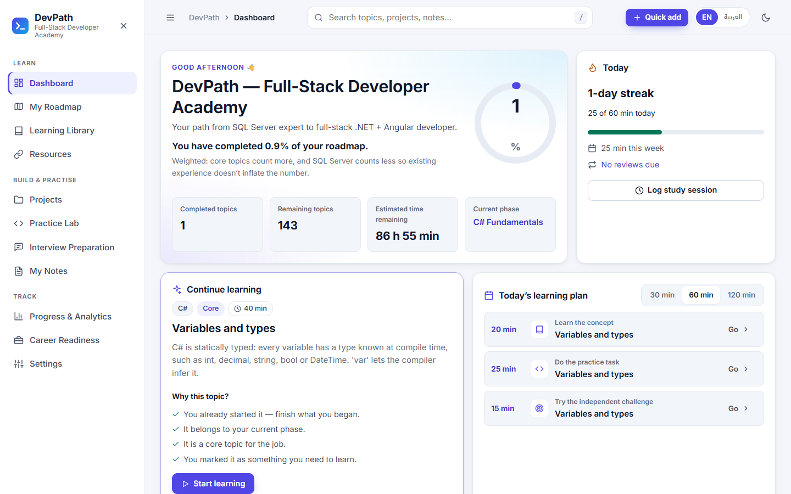
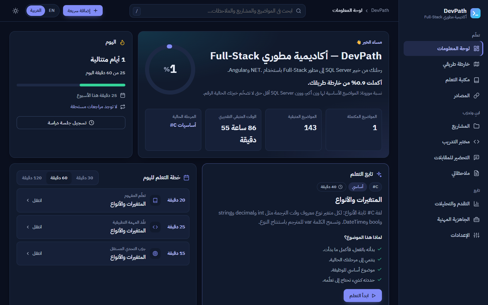
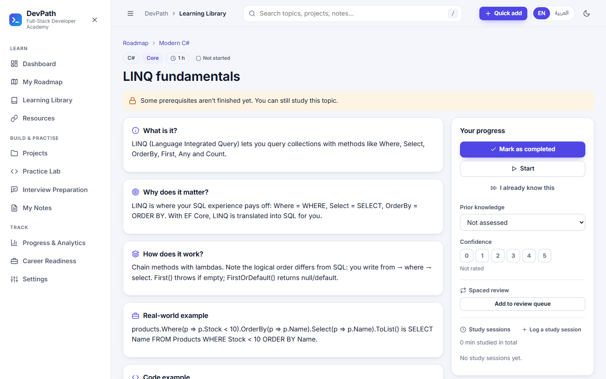
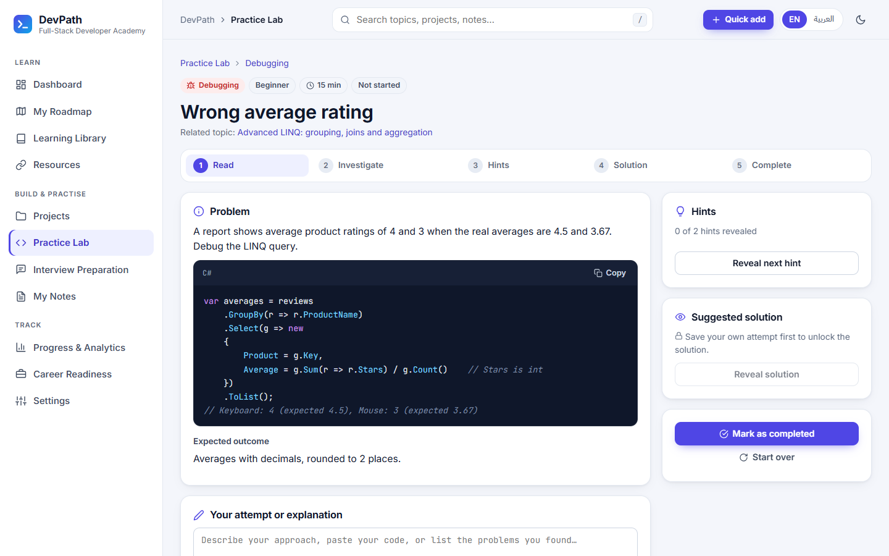
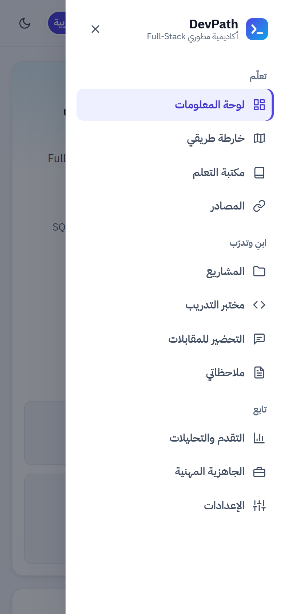

# DevPath — Full-Stack Developer Academy

A bilingual (English / العربية) learning platform with private accounts that takes beginners from their first line of code to **full-stack .NET + Angular developer**.
It combines a personalised roadmap, four practical projects, a practice lab, interview preparation, notes, spaced review, analytics and a career-readiness view.
New accounts confirm their email and are approved by an administrator before they can use the app. It runs locally for development and can be published as a single site to MonsterASP.NET ([deployment guide](docs/DEPLOYMENT.md)).

```text
Angular 22 + TypeScript   →   ASP.NET Core 10 Web API (C#)   →   EF Core 10   →   Local SQL Server (LocalDB)
        (port 4200)                    (port 5080)
```

| Dashboard (English, light) | Dashboard (Arabic, dark, RTL) |
|---|---|
|  |  |

| Topic page | Practice Lab | Mobile menu (Arabic) |
|---|---|---|
|  |  |  |

---

## Contents

1. [Features](#features)
2. [Prerequisites](#prerequisites)
3. [Quick start](#quick-start)
4. [SQL Server setup](#sql-server-setup)
5. [Project structure](#project-structure)
6. [Architecture and design decisions](#architecture-and-design-decisions)
7. [Data model](#data-model)
8. [API endpoints](#api-endpoints)
9. [Accounts and data privacy](#accounts-and-data-privacy)
10. [Email verification, approval and administration](#email-verification-approval-and-administration)
11. [Deployment](#deployment)
12. [YouTube videos](#youtube-videos)
13. [Code runners](#code-runners)
14. [CV Builder](#cv-builder)
15. [Onboarding tour and help](#onboarding-tour-and-help)
16. [Bilingual UI and right-to-left support](#bilingual-ui-and-right-to-left-support)
17. [How progress, recommendations and reviews are calculated](#how-progress-recommendations-and-reviews-are-calculated)
18. [Editing the learning content](#editing-the-learning-content)
19. [Tests](#tests)
20. [Troubleshooting](#troubleshooting)
21. [Known limitations](#known-limitations)
22. [Ideas for future improvements](#ideas-for-future-improvements)

---

## Features

- **Accounts**: sign-up, sign-in, sign-out, password reset and password change. Every account has its own private progress, notes, sessions, reviews, projects, practice answers, interview ratings, preferences and videos (see [Accounts and data privacy](#accounts-and-data-privacy)).
- **Videos on every topic**: 3–4 hand-picked English YouTube tutorials per topic (598) plus up to two Arabic explanations (139 videos on 84 of the 150 topics), all checked to exist and allow embedding, with a language filter, durations and short descriptions, optional live suggestions from the YouTube API, plus your own videos added by link, with an in-page player and per-account "watched" and "saved" flags (see [YouTube videos](#youtube-videos)).
- **A quiz on every topic**, right under the videos: 600 bilingual multiple-choice questions (4 per topic) in three levels that open one after another: the topic itself, the topic mixed with the topics just before it, and a wider review of the topics leading up to it. You need 75% to open the next level. The API grades answers, so the correct options never reach the browser before you answer, and each answer comes with a short explanation. The questions test each topic's ideas (what the videos teach); they weren't written from individual video transcripts.
- **Dashboard**: weighted overall progress, completed and remaining topics, time remaining, current phase, a "continue learning" recommendation with its reasons, a 30/60/120-minute study plan, project progress, per-skill progress, recent activity, study streak and quick actions.
- **Roadmap**: 13 phases and 150 topics, from C# fundamentals to full-stack projects. No prior experience is assumed: phase 5 starts with databases and SQL from zero (tables, `SELECT`, `INSERT`/`UPDATE`/`DELETE`, keys, `JOIN`, `GROUP BY`) before EF Core, and phase 6 applies SQL Server in real applications. Any topic can still be marked "already known" from its page.
- **Topic pages** cover: what it is, why it matters, how it works, a real-world example, a code example, a practice task, an independent challenge, verified resources, prerequisites, topics it unlocks, related projects, interview questions, exercises and notes. You can also set status, prior knowledge, confidence (0–5), add the topic to spaced review, and log study sessions.
- **Learning Library**: server-side search, filters (skill, phase, status, priority, knowledge) and pagination. The filters are kept in the URL.
- **Four projects**: Employee Management (C# console), Inventory API, Project Dashboard (Angular) and Sales and Order Management (full stack). They have 16 milestones, 62 tasks with acceptance criteria and topic links, 15 realistic **change requests** that unlock as a project progresses, a portfolio checklist and a repository link. Every task and change request has 3–4 YouTube videos on how to build that part (280 hand-picked videos in `SeedData/project-videos.json`, each checked with YouTube; tasks with fewer are topped up from their related topics' videos).
- **Practice Lab**: 140 exercises across the whole roadmap (C#, OOP, LINQ, ASP.NET Core, EF Core, SQL, TypeScript, Angular, testing, Git and professional skills): coding, debugging, conceptual, practical, mini projects, advanced challenges and 10 **full-stack challenges** with a scenario, technologies, requirements, acceptance criteria, hints and bonus tasks. Four levels (Beginner → Expert); filters by technology, topic, level, type and status, plus search; progress per technology from what you actually solved. Exercises open in an editor: C#, SQL, TypeScript and JavaScript exercises run **automatic checks** in your browser (submitting records your score, and passing every check completes the exercise), Angular exercises run a live preview, and project-style tasks (controllers, EF Core, tests, Git) are edited here and built locally. The API still enforces *attempt → hints → solution*.
- **Code Playground**: an in-browser IDE (Monaco, the editor of VS Code) for C#, SQL, TypeScript, JavaScript, HTML/CSS and multi-file Angular projects, with a file explorer, tabs, console, problems panel, tests, live preview, save/autosave/restore, import and download as .zip, and full screen. **All code runs in your browser**, never on the server: C# with the Roslyn compiler on .NET WebAssembly, SQL on SQLite (sql.js) with the common T-SQL syntax translated, JavaScript in a worker, and previews in a sandboxed frame without access to your session (see [Code runners](#code-runners)).
- **CV Builder**: create several private CVs from six genuinely different templates (Modern, ATS-friendly, Minimalist, Technical two-column, Executive, Creative), edit them section by section beside a live preview of the real PDF, and download a **PDF with selectable text** or an **editable Word (.docx)** file. Suggestions come from your real activity, labelled *verified / built / practiced / studied*; an optional **AI assistant** (Claude) improves wording and tailors a CV to a job description without inventing anything; a rule-based **ATS check** and job-description match need no AI (see [CV Builder](#cv-builder)).
- **Video library**: every topic's videos in one place, organised by the roadmap, with a language filter (English / Arabic), durations and short descriptions.
- **Interview preparation**: 855 bilingual questions in 17 categories (at least 50 each), each linked to a topic. Besides the stack (C#, .NET, ASP.NET Core, EF Core, SQL Server, TypeScript, Angular, REST, testing, Git, full-stack design) it covers the classic coding-interview themes: data structures, algorithms, object-oriented design, system design, concurrency and behavioral questions. These are written for this project, not copied from any book. Study mode shows question and answer, with search, difficulty and rating filters; practice mode shows one question at a time and you rate yourself (need review / partial / confident).
- **Resources**: 157 free, mostly official links. Each one was checked over HTTP when it was seeded, and a **"Check all links"** button re-verifies them on demand.
- **Notes**: a searchable knowledge base. A note can be linked to a topic, project, task or interview question. Deleting asks for confirmation, and you're warned about unsaved changes.
- **Progress and analytics**: separate progress per technology and per phase, a confidence distribution, project and practice completion, interview stats, study time per week, achievements, weak areas, a **weekly review** with suggested priorities, and the **spaced-review queue**.
- **Career readiness**: eight evidence-based areas, each with an explanation, the evidence behind it and a next step, plus the portfolio checklist for every project. There is deliberately no single "job-ready %".
- **Global search** (press <kbd>/</kbd>) across topics, projects, tasks, exercises, interview questions, resources and notes, in English or Arabic.
- **Bilingual UI** with full RTL layout, **light/dark/system themes**, a responsive layout (desktop to mobile drawer), keyboard support, skeletons, empty and error states, toasts, confirmation dialogs and reduced-motion support.

## Prerequisites

| Tool | Version used here | Check |
|---|---|---|
| .NET SDK | 10.0 | `dotnet --list-sdks` |
| Node.js / npm | Node 22+ (tested on 26) | `node --version` |
| SQL Server | **LocalDB** (installed with Visual Studio / SQL Server Express) *or* any local SQL Server instance | `sqllocaldb info` |
| EF Core CLI | 10.x | `dotnet tool install --global dotnet-ef` |
| VS Code | with the recommended extensions in `.vscode/extensions.json` | |

## Quick start

```bash
# 1) Backend: restore, create the database, run (http://localhost:5080)
cd backend/DevPath.Api
dotnet restore
dotnet ef database update      # creates the "DevPath" database on LocalDB
dotnet run                     # also seeds the learning content on start-up
```

```bash
# 2) Frontend, in a second terminal (http://localhost:4200)
cd frontend
npm install
npm run build:runners          # once (and after changing backend/DevPath.CodeRunner): builds the in-browser code runners
npm start                      # = ng serve
```

Open **http://localhost:4200**, create an account on the sign-up page, and you're in. In VS Code you can instead run the task **"dev: start everything"**, or use the **"Full stack: API + Web"** debug configuration.

> The API applies pending migrations and runs the idempotent content seeder every time it starts (`Database:MigrateOnStartup` / `Database:SeedOnStartup` in `appsettings.json`). Running `dotnet ef database update` first isn't strictly required, but it's the standard workflow and good practice.

## SQL Server setup

The default connection string uses **LocalDB with Windows authentication**, so it contains no password:

```json
"ConnectionStrings": {
  "DevPath": "Server=(localdb)\\MSSQLLocalDB;Database=DevPath;Trusted_Connection=True;TrustServerCertificate=True"
}
```

- **Check LocalDB:** `sqllocaldb info MSSQLLocalDB`, then `sqllocaldb start MSSQLLocalDB`.
- **No LocalDB?** Install *SQL Server Express* (choose the LocalDB feature) or Visual Studio's "Data storage and processing" workload.
- **Using a full SQL Server instance instead** (for example the `MSSQLSERVER` service): start the service and override the connection string with **user secrets**, which are stored outside the repository:

  ```bash
  cd backend/DevPath.Api
  dotnet user-secrets set "ConnectionStrings:DevPath" "Server=localhost;Database=DevPath;Trusted_Connection=True;TrustServerCertificate=True"
  # SQL authentication (never commit this):
  # dotnet user-secrets set "ConnectionStrings:DevPath" "Server=localhost;Database=DevPath;User Id=devpath;Password=...;TrustServerCertificate=True"
  ```

- **No LocalDB on this machine?** Point the API at your local instance for the current terminal only, without changing any file:

  ```bash
  # bash
  ConnectionStrings__DevPath="Server=localhost;Database=DevPath;Trusted_Connection=True;TrustServerCertificate=True" dotnet run
  ```
  ```powershell
  # PowerShell
  $env:ConnectionStrings__DevPath = "Server=localhost;Database=DevPath;Trusted_Connection=True;TrustServerCertificate=True"; dotnet run
  ```

- **Inspect the data** in SSMS, Azure Data Studio or the VS Code *SQL Server (mssql)* extension by connecting to `(localdb)\MSSQLLocalDB`. Enums are stored as readable strings such as `'Completed'`.
- **Back up before experimenting** with schema changes: `sqlcmd -S "(localdb)\MSSQLLocalDB" -E -Q "BACKUP DATABASE DevPath TO DISK='C:\temp\DevPath.bak'"`.
- **Generate a reviewable SQL script** for the migrations: `dotnet ef migrations script --idempotent -o devpath.sql`.

## Project structure

```text
Roadmap/
├── DevPath.slnx                      # .NET solution
├── backend/
│   ├── DevPath.Api/
│   │   ├── Controllers/              # thin HTTP layer (8 controllers)
│   │   ├── Data/
│   │   │   ├── AppDbContext.cs       # model configuration: keys, indexes, check constraints, delete rules
│   │   │   ├── DatabaseInitializer.cs
│   │   │   └── Seeding/              # idempotent seeder + seed-file shapes
│   │   ├── DTOs/                     # API contracts (records)
│   │   ├── Middleware/               # GlobalExceptionHandler (ProblemDetails), RequestTimingMiddleware
│   │   ├── Migrations/               # EF Core migrations
│   │   ├── Models/                   # entities: content vs user data
│   │   ├── SeedData/                 # learning content (JSON) + code snippets (.cs/.ts/.sql…)
│   │   ├── Services/                 # business logic, calculators, recommendation engine
│   │   ├── Validation/               # consistent 400 responses
│   │   ├── DevPath.Api.http          # example requests (REST Client)
│   │   └── Program.cs
│   └── DevPath.Api.Tests/            # xUnit: unit, seeder and HTTP API tests
├── frontend/
│   └── src/app/
│       ├── core/                     # ApiService, models, loader, i18n (en.ts / ar.ts), theme/toast/confirm
│       ├── shared/                   # icons, progress ring/bar, code block + highlighter, states, dialogs
│       ├── layout/                   # shell, global search, study-session dialog
│       ├── features/                 # one folder per page (lazy-loaded routes)
│       ├── app.routes.ts
│       └── app.config.ts
├── docs/screenshots/
└── .vscode/                          # tasks, launch configs, recommended extensions
```

## Architecture and design decisions

- **Modular monolith with no extra layers.** Controllers call services, and services use `AppDbContext` directly. There's no generic repository, CQRS or MediatR, because nothing here needs them.
- **Content and user data are kept apart.** Seeded tables (`Topics`, `Projects`, `PracticeExercises`…) are separate from user-owned tables (`TopicProgress`, `Notes`, `StudySessions`…). The seeder never touches user tables, so re-seeding or editing content can't wipe your progress.
- **One canonical record per topic.** English and Arabic live in `…En` / `…Ar` columns on the same row, and every relationship (prerequisites, resources, tasks, exercises, questions, notes, reviews) points to that single topic id.
- **Pure calculation code.** Progress, recommendations and review scheduling are pure functions over a small in-memory snapshot (`LearningState`), so they're transparent and unit-tested.
- **Consistent errors.** All errors are RFC 7807 `ProblemDetails` with a stable `code` (`not_found`, `attempt_required`, `task_locked`, `validation_failed`…) that the UI translates. Stack traces are logged, never returned.
- **Safety:** parameterised queries everywhere (LIKE wildcards are escaped), DTOs (no over-posting), server-side validation, check constraints in the database, CORS limited to the Angular origin, and no secrets in the repository.
- **Frontend:** standalone components, signals, zoneless change detection, Reactive Forms, lazy routes and one `ApiService`. A small `createLoader()` helper gives every page loading, error and empty states.
- **Offline-friendly:** fonts are bundled locally with Fontsource, icons are inline SVG, and nothing calls external services except the resource links you open and the optional link checker.

## Data model

```text
Phase 1──* Topic *──* Topic            (TopicPrerequisite: Topic → PrerequisiteTopic)
             │ *──* Resource           (ResourceTopic)
             │ 1──* PracticeExercise
             │ 1──* InterviewQuestion
             │ *──* ProjectTask        (ProjectTaskTopic)
             └ 1──0..1 TopicVideoCache (shared YouTube suggestions)
Project 1──* ProjectMilestone 1──* ProjectTask
Project *──* PortfolioChecklistItem

AppUser (AspNetUsers) 1──* every user table below; each row is (UserId, …) and private to that account
  TopicProgress (UserId, TopicId)           status, prior knowledge, confidence 0–5
  ReviewSchedule (UserId, TopicId)          spaced review; references the topic, never a copy
  PracticeProgress (UserId, ExerciseId)     ProjectTaskProgress (UserId, ProjectTaskId)
  InterviewProgress (UserId, QuestionId)    PortfolioCheck (UserId, ProjectId, ChecklistItemId)
  ProjectRepository (UserId, ProjectId)     LearningPreference (UserId)
  StudySession, Note (Id + UserId)          Note → at most one of Topic / Project / ProjectTask / InterviewQuestion
  UserTopicVideo (Id + UserId)              VideoProgress (UserId, VideoId): watched / saved
  QuizAttempt (Id + UserId): topic, level, score
```

Content tables have foreign keys, unique indexes on every slug/key, check constraints (confidence 0–5, minutes 1–1440, a note linked to at most one item, no self-prerequisite) and delete rules chosen to avoid SQL Server's multiple-cascade-path error. Deleting an account deletes its rows. Derived values such as percentages and achievements are **calculated, not stored**.

## API endpoints

| Method | Route | Purpose |
|---|---|---|
| GET | `/api/health` | API + database status (used by the offline banner) |
| GET | `/api/dashboard` | Dashboard data |
| GET | `/api/roadmap` | Phases → topics with progress |
| GET | `/api/topics?q&skill&status&phaseId&priority&knowledge&page&pageSize` | Paged, filtered topics |
| GET | `/api/topics/{id}` | Topic detail with all relationships |
| PUT | `/api/topics/{id}/progress` | Status, prior knowledge, confidence |
| GET | `/api/recommendations?minutes&take` | "What should I study next?" with reasons |
| GET | `/api/study-plan?minutes` | 15–240-minute plan |
| GET/POST/DELETE | `/api/study-sessions` | Study sessions (no future dates) |
| GET | `/api/projects`, `/api/projects/{id}`, `/api/projects/{id}/tasks` | Projects, milestones, tasks, change requests, portfolio |
| PUT | `/api/project-tasks/{id}/progress` | Task status (409 if locked; 400 if blocked without a reason) |
| PUT | `/api/projects/{id}/portfolio/{itemId}`, `/api/projects/{id}/repository` | Portfolio checklist, repo URL |
| GET | `/api/resources?topicId&type&skill&q` | Resources |
| POST | `/api/resources/verify` | Re-check every link over HTTP |
| GET | `/api/practice?type&topicId&skill&difficulty&status&runner&q`, `/api/practice/{id}` | Exercises with per-technology statistics (hints and solution only once revealed) |
| PUT/POST | `/api/practice/{id}/attempt`, `/hints`, `/solution`, `/status` | Practice workflow |
| PUT/POST | `/api/practice/{id}/files`, `/api/practice/{id}/submissions`, `/api/practice/{id}/criteria` | Save your exercise files, record a checked submission (score), tick acceptance criteria |
| GET/POST/PUT/DELETE | `/api/playground/projects`, `/api/playground/projects/{id}` | Your saved Code Playground projects (up to 100) |
| GET/POST/PUT/DELETE | `/api/cv`, `/api/cv/{id}`, `/api/cv/{id}/duplicate` | Your CVs (up to 30); a copy or tailored version never changes the original |
| GET/PUT/DELETE | `/api/cv/{id}/photo` | Optional photo (JPEG/PNG, checked by content, ≤ 300 KB) |
| POST, GET | `/api/cv/{id}/preview`, `/api/cv/{id}/pdf`, `/api/cv/{id}/docx` | Preview pages of the on-screen state; PDF and Word downloads of the saved CV |
| GET | `/api/cv/templates`, `/api/cv/templates/{key}/thumbnail`, `/api/cv/suggestions?lang=en\|ar` | Templates; suggestions from your activity with their evidence |
| POST | `/api/cv/ats-check`, `/api/cv/{id}/job-match` | Rule-based ATS check and job-description keyword match |
| GET, POST | `/api/cv/ai/status`, `/api/cv/{id}/ai` | AI assistant (only when `Anthropic:ApiKey` is set; 40 requests per account per day) |
| GET | `/api/videos/library?language=English\|Arabic` | Every topic's curated videos, by phase (all languages without `language`) |
| GET | `/api/videos/saved` | The videos you saved, newest first, with the topic each was saved from |
| GET/PUT | `/api/interviews?category&topicId&rating`, `/api/interviews/{id}/progress` | Interview questions and self-rating |
| GET/POST/PUT/DELETE | `/api/notes`, `/api/notes/{id}` | Notes CRUD and search |
| GET/PUT/POST/DELETE | `/api/reviews`, `/api/reviews/{topicId}`, `/api/reviews/{topicId}/complete` | Spaced-review queue |
| GET | `/api/progress`, `/api/progress/weekly?weekOf` | Analytics, weekly review |
| POST | `/api/auth/register`, `/api/auth/login`, `/api/auth/logout` | Create an account, sign in, sign out (sets or clears the HttpOnly cookie) |
| GET | `/api/auth/me` | The signed-in account with its status and role (401 when signed out) |
| POST | `/api/auth/verify-email`, `/api/auth/resend-verification` | Confirm the email with the emailed token; send a new link (once a minute) |
| POST | `/api/auth/forgot-password`, `/api/auth/reset-password`, `/api/auth/change-password` | Password recovery and change |
| GET | `/api/admin/overview`, `/api/admin/users?q&status&page&pageSize`, `/api/admin/users/{id}`, `/api/admin/audit` | Admin statistics, account list and details, activity log (administrators) |
| POST | `/api/admin/users/{id}/approve`, `/reject`, `/suspend`, `/reactivate`, `/resend-verification` | Account approval actions (administrators) |
| PUT / DELETE | `/api/admin/users/{id}/name`, `/api/admin/users/{id}` | Rename an account; delete an account and everything it saved, permanently (administrators; other administrators only by the main administrator; never yourself or the main administrator) |
| POST/DELETE | `/api/admin/admins`, `/api/admin/admins/{id}`; POST `/api/admin/test-email` | Grant or revoke administrator rights, test email (main administrator only) |
| GET/POST | `/api/topics/{id}/videos` | Suggested + your own videos for a topic; add a video by YouTube link |
| GET | `/api/project-tasks/{id}/videos` | Videos showing how to build a project task |
| GET/POST | `/api/topics/{id}/quiz?level=1-3` | Quiz questions (without answers); submit answers to be graded |
| DELETE | `/api/topic-videos/{id}` | Remove a video you added |
| PUT | `/api/videos/{videoId}/progress` | Your "watched" / "saved" flags for a video |
| GET | `/api/career-readiness` | Readiness areas and portfolio checklist |
| GET | `/api/search?q` | Global search (min. 2 characters) |
| GET/PUT | `/api/preferences` | Learning preferences |

Every endpoint except `/api/health` and the sign-up, sign-in, verification and password-recovery endpoints requires a signed-in account and answers **401** with code `unauthenticated` otherwise. The learning endpoints also require an **approved** account and answer **403** with `account_pending_verification`, `account_pending_approval`, `account_rejected` or `account_suspended`; admin endpoints answer 403 `admin_required` / `owner_required`.

The full OpenAPI document is at `http://localhost:5080/openapi/v1.json` (Development only). Example requests are in [`DevPath.Api.http`](backend/DevPath.Api/DevPath.Api.http).

## Accounts and data privacy

- **Authentication** uses **ASP.NET Core Identity** with the same SQL Server database (`AspNetUsers`…). Passwords are stored as salted PBKDF2 hashes, never as text. Rules: at least 8 characters with a letter and a digit; emails are unique (case-insensitive, also enforced by a unique index); 5 wrong passwords lock the account for 5 minutes; sign-up, sign-in and password-reset requests are rate-limited per client address (`Auth:AttemptsPerMinute`).
- **Sessions** are an **HttpOnly, SameSite=Strict cookie** (`devpath.auth`, 14 days, sliding; `Secure` in production). JavaScript can't read it, it survives page refreshes, and the browser won't send it from other sites. Changing or resetting the password signs out your other devices immediately. When a session ends, the next API call answers 401 and the app returns to the sign-in page, then back to where you were.
- **Every endpoint is protected on the server** by a fallback authorization policy; the Angular guards only decide navigation.
- **Data isolation is enforced in the database layer.** Every user table has a `UserId` column (foreign key to `AspNetUsers`, cascade delete) and is part of the key (for example `TopicProgress (UserId, TopicId)`). `AppDbContext` adds a **global query filter** `UserId == current user` to every user table, and fills in `UserId` itself when a row is saved, refusing to change or delete another account's row. So a service can't return someone else's data even if it forgets a `Where`, and putting another account's id in a URL or body simply returns **404**.
- **Shared content** (phases, topics, resources, projects, exercises, interview questions, quiz questions, curated videos and the cached YouTube suggestions) is the same for everyone and read-only.
- **Password reset**: the emailed link expires after 1 hour and works once; the token alone identifies the account and only its hash is stored. Locally (`Email:Provider` = `Log`) emails are written to the **API console** instead of being sent; production sends them through Brevo ([docs/EMAIL.md](docs/EMAIL.md)).

### Data from before accounts existed

The `AddAccountsAndVideos` migration keeps any progress, notes and other personal data that already exist (nothing is deleted). Because that data has no owner, it is kept under a placeholder account (`legacy-local-data`) that can't sign in, and nobody sees it. To move it to your account, create the account, then run once:

```bash
cd backend/DevPath.Api
dotnet user-secrets set "LegacyData:AssignToEmail" "you@example.com"
dotnet run      # the log says how many rows were moved
dotnet user-secrets remove "LegacyData:AssignToEmail"
```

The target account must have no data of its own yet, so nothing is overwritten. A fresh database has no legacy data and no placeholder account.

## Email verification, approval and administration

1. **Sign up** → the account is `PendingEmailVerification` and a confirmation link is emailed (valid 24 hours, single use).
   The user is signed in but only sees the **account status** page (resend the email, check again, sign out).
2. **Confirm the email** (`/verify-email?token=…`, works signed in or not) → `PendingApproval`.
3. An **administrator approves** the account in **Administration** (`/admin`) → `Approved`, and the user gets an email.
   Administrators can also reject (with an optional note), suspend, reactivate and resend the confirmation email.
   Every action is confirmed in a dialog and recorded in the activity log.

The **main administrator** is the address in `Admin:OwnerEmail` (server configuration, `muhammadssaeed0@gmail.com` by default). That account
becomes the owner only with the deployment secret `Admin:OwnerPassword` or after a password reset through that inbox, so
registering the address isn't enough. The owner grants and revokes administrator rights and can't be suspended or
demoted. Accounts created before this feature keep working (they were migrated as approved). Details and the
security review: [docs/SECURITY.md](docs/SECURITY.md).

**Locally:** emails appear in the API console. To try the admin area, either set a first owner password
(`dotnet user-secrets set "Admin:OwnerPassword" "<a strong password>"` in `backend/DevPath.Api`, then restart; it's only
used when no account has that address), or register with the owner address and use **Forgot password**, following
the link from the console.

## Deployment

DevPath publishes as one site (the API serves the Angular app) to **MonsterASP.NET** or any IIS host with Web Deploy:

```powershell
copy deploy\production.env.example deploy\production.env   # fill in; git-ignored
./deploy/publish.ps1             # tests, build, configuration check, migration script
./deploy/publish.ps1 -Deploy     # publish with Web Deploy and smoke-test the live site
```

A manual GitHub Actions workflow does the same from repository secrets. Everything, including the MonsterASP.NET
set-up, the settings, HTTPS and troubleshooting, is in [docs/DEPLOYMENT.md](docs/DEPLOYMENT.md); email set-up is in
[docs/EMAIL.md](docs/EMAIL.md).

## YouTube videos

Each topic page has a **Videos** section:

- **Curated videos (no setup needed):** `SeedData/videos.json` lists 3–4 English tutorials for every topic (598) and up to two **Arabic** explanations (139 videos, on 84 of the 150 topics). Each entry has `language` (`en` / `ar`) and, where known, `duration` and a short `description` taken from the video. Arabic videos were chosen only when they are originally in Arabic (spoken Arabic, not an English video with a translated title or an automatic Arabic dub), about the topic and the roadmap's technology, and playable; topics without a suitable Arabic video simply show the English ones. The learner's language choice (All / English / Arabic) is remembered across the video library and topic pages. They were found by searching the web for each topic and then checked one by one with YouTube (the video exists, is public and allows embedding); titles and channel names come from YouTube itself. The seeder loads them into the `CuratedVideos` table like any other content and keeps the table in sync with the file. They are shown whenever live suggestions aren't available.
- **Live suggestions (optional)** are found with the **YouTube Data API v3** when you set an API key: the API searches for "*skill* + *topic title* tutorial" (for example "C# Loops tutorial"), confirms each result is public, processed and embeddable, and drops Shorts, very long streams, near-duplicate titles, videos for another stack (a C# topic won't show Python) and videos whose title doesn't mention the topic. Results are **cached per topic for 30 days** and shared by all accounts, so each topic costs about 101 quota units a month (the free daily quota is 10,000).
- **Add your own** by pasting any YouTube link (watch, youtu.be, shorts or embed). The API checks it with YouTube's public oEmbed endpoint, so this works **without an API key**, and rejects missing, private and non-embeddable videos. Added videos are private to your account.
- Videos play in the page with the privacy-enhanced player (`youtube-nocookie.com`), loaded only when you click; every card also links to YouTube.
- **"Watched" and "Saved"** flags are stored per account.
- Without an API key, or when YouTube is unreachable or the daily quota runs out, the curated videos are shown instead, so a topic is never empty.

**To turn on live suggestions** (optional), create an API key in Google Cloud (enable *YouTube Data API v3*), then store it outside the repository:

```bash
cd backend/DevPath.Api
dotnet user-secrets set "YouTube:ApiKey" "YOUR_KEY"
```

The key is used only by the API; it is never sent to the browser.

## Code runners

The Practice Lab and the Code Playground run code **in the learner's browser only**. The server stores files and scores but never compiles or executes learner code, so a runaway or malicious program can only affect its own browser tab.

| Language | How it runs | Built from |
|---|---|---|
| C# | Roslyn compiles to an in-memory assembly on the .NET 10 WebAssembly runtime, inside a Web Worker; `Console.ReadLine` reads the Input panel; `[Test]` methods with `Assert` are the automatic checks | `backend/DevPath.CodeRunner` → `npm run build:runners csharp` |
| SQL | SQLite compiled to WebAssembly (sql.js) with sample databases (shop, hr, school); common T-SQL (`TOP`, `IDENTITY`, `GETDATE()`, `N'…'`, `GO`, `OFFSET … FETCH`, `ISNULL`, `LEN`…) is translated and each translation is listed in the output | the `sql.js` package |
| TypeScript / JavaScript | compiled by the TypeScript service already running in the editor, then run in a fresh Web Worker per run with a small `test()` / `expect()` framework | — |
| HTML/CSS and Angular | a live preview in a sandboxed iframe; Angular is compiled just in time from a bundled copy of `@angular/*` and RxJS | `npm run build:runners angular` |

**Isolation.** The runners live in a sandboxed iframe (`sandbox="allow-scripts"`) with an opaque origin, so learner code can't read the site's cookies or call the API as the learner. Each engine runs in its own worker, which is terminated on a time limit (and on Stop) and restarted, so an endless loop can't freeze the page. Output is capped. `/runners/*` gets its own Content-Security-Policy (`wasm-unsafe-eval` for WebAssembly, `blob:` workers), while the rest of the site keeps the strict policy.

**Build.** The C# runner and the Angular preview packages are generated (`npm run build:runners`, not committed). The deploy script builds them before `ng build` and then writes Brotli copies of the build (`npm run precompress`), which the API serves to browsers that accept them: the C# runtime is about 66 MB raw and 9 MB compressed, and the browser caches it.

**Checks.** `npm run verify:exercises` (frontend) and `PracticeExerciseTests` (backend) run every exercise through the same code the browser uses and fail if a model solution doesn't pass all its checks or a starter already does.

## CV Builder

**CV Builder** in the sidebar (`/cv`). Each CV is private to its account (the same per-user query filter as notes and
progress); there is no public link.

- **Templates.** Six layouts drawn differently, not recoloured: *Modern Professional*, *ATS-Friendly* (plain, black,
  no graphics or photo), *Minimalist*, *Technical Developer* (sidebar with skills and links, projects first),
  *Executive / Corporate* (serif) and *Creative Modern* (full-height coloured sidebar with photo). The content is
  stored separately from the look, so switching templates never loses anything. Colour, font, spacing (comfortable /
  compact), section order and visibility, and an English (LTR) or Arabic (RTL) CV are set per CV.
- **One renderer.** QuestPDF draws the CV; the live preview shows images of the same pages the PDF will have, so
  page breaks are exactly what you download. The PDF has real, selectable text (ATS can read it) with embedded Noto
  fonts that cover Arabic (`Resources/Fonts`, SIL Open Font License). The Word export is a real OpenXML document
  (headings, bullet lists, tab-aligned dates, links) in one editable column, validated in the tests with the OpenXML
  validator. QuestPDF is used under its free **Community licence** (free for individuals, non-profits and companies
  under 1M USD annual revenue; see questpdf.com/license).
- **Suggestions from your progress** never overstate: *verified* = an exercise that passed every automatic check,
  *built* = a platform project with a repository link where you finished tasks that use the skill, *practiced* =
  exercises or project tasks you marked done, *studied* = completed topics. Unfinished projects are offered as
  *in progress*, coursework only for phases whose core topics are all completed, and roadmap progress is never
  offered as a certification. Nothing is added until you click **Add**.
- **AI assistant (optional).** With an Anthropic API key the editor can write a summary from your CV and evidence,
  improve wording, turn notes into bullet points, make text shorter or ATS-friendly, suggest and group skills, list
  what is missing, and tailor the CV to a pasted job description. The prompt forbids inventing employers, dates,
  numbers, certificates or skills; the job description is treated as data, not instructions; answers use structured
  output and are only proposals that you apply or discard. Refusals, rate limits and errors are shown as clear
  messages. Without a key the assistant says it is not set up and everything else works.
- **Job match and ATS check** are rule-based (no AI, no cost): keywords from the job description that your CV
  already shows, ones on your learning path, and missing ones; projects to highlight; a suggested section order; and
  an ATS-readiness score with concrete issues (missing contact details, two-column layout, no dates, long bullets,
  more than two pages…). The score is a guide, not a promise about any real ATS. **Create tailored copy** saves a
  separate CV for that job and leaves the original untouched.

**To turn on the AI assistant**, create a key at [console.anthropic.com](https://console.anthropic.com) and store it
outside the repository (it is used only by the API and never sent to the browser):

```bash
cd backend/DevPath.Api
dotnet user-secrets set "Anthropic:ApiKey" "YOUR_KEY"
# optional: dotnet user-secrets set "Anthropic:Model" "claude-opus-5-5"   (the default)
```

In production set the environment variable `Anthropic__ApiKey` (GitHub secret `ANTHROPIC_API_KEY` for the automated
deployment). Each account may make 40 AI requests a day (`Anthropic:RequestsPerDay`); the count is kept in
memory, so it starts again when the app restarts.

## Onboarding tour and help

- **First visit:** an approved account is greeted once with a short welcome and the choice to take the tour or skip it.
  Nothing is forced; the app is usable underneath, and closing the welcome counts as "seen".
- **Guided tour:** 20 steps (21 for administrators) across the menu, search, quick add, language and theme, the
  dashboard and every main page, moving between pages by itself. Each step highlights the real element and explains
  it, with Back / Next / Skip / Close, a "Step 3 of 21" indicator, arrow keys and Esc. Closing part-way remembers
  the step; **Help → Continue the tour** picks it up again, even after a refresh.
- **Help, any time:** the **?** button in the top bar (a round button in the corner on phones) offers:
  explore the website (restart the tour), learn about this page (a walk through each part of the current page),
  explore a specific section (click any highlighted part to see what it does), and quick help (the page at a glance
  with tips; also on the **?** key).
- **Where things live:** `core/tour/tour.config.ts` lists what can be explained and in which order, keyed by
  `data-tour="…"` attributes on the elements; `tour-content.en.ts` / `.ar.ts` hold the texts (loaded only when needed,
  and a missing translation fails the build); `layout/tour/` has the overlay, the welcome and the help menu. Routes
  name their page guide in `data.helpId`. To explain something new: add an id to `SECTION_IDS`, put `data-tour` on
  the element, list it under its page in `PAGE_HELP`, and write its text in both languages.
- **Progress** is stored per account in the browser (`localStorage`): it only decides whether to greet someone, so it
  doesn't need a database change, and a new device simply offers the tour again.

## Bilingual UI and right-to-left support

- **UI strings** are in `frontend/src/app/core/i18n/en.ts` and `ar.ts`. The `Translations` type makes `ar.ts` match `en.ts` key for key, so a missing Arabic string is a **compile error**. Components use the `t` pipe: `{{ 'nav.dashboard' | t }}`.
- **Learning content** comes from the API in both languages, and the `loc` pipe picks the right field (`{{ topic | loc: 'title' }}`), falling back to English. Switching language is instant, with no new request.
- **Direction:** `I18nService` keeps the language in a signal. An effect sets `<html lang>` and `<html dir="rtl|ltr">` and saves the choice in `localStorage`. A tiny script in `index.html` applies the saved language and theme before Angular starts, so there's no flash.
- **Layout mirrors automatically**, because all CSS uses logical properties (`margin-inline-start`, `inset-inline-end`…). Directional icons (chevrons, arrows) are flipped in RTL; the mobile drawer slides in from the right.
- **Code stays left-to-right:** code blocks, URLs and the tech-stack lines use `dir="ltr"`.
- **Mixed Arabic and English text:** invisible left-to-right marks are added so that `C#`, `.NET`, `First()` and `409 Conflict` don't get reordered inside Arabic sentences.
- **Fonts:** Inter for English, IBM Plex Sans Arabic for Arabic and JetBrains Mono for code, all bundled locally. Dates use Arabic month names with Western digits (`ar-EG-u-nu-latn`), so they read well next to code and percentages.

## How progress, recommendations and reviews are calculated

**Weighted progress** (`Services/ProgressOptions.cs`, configurable in `appsettings.json` → `Progress`):

```text
topic weight = priority weight (Core 3, Important 2, Optional 1) × skill weight (C# 1.0, SQL Server 1.0, Professional 0.7, Git 0.6 …)
progress %   = Σ weight of finished topics ÷ Σ weight of all topics
```

Supporting skills (Git, professional skills) weigh a little less than the core stack. Per-skill and per-phase progress, confidence, projects and interview practice are always shown **separately**.

**"What should I study next?"** (`Services/RecommendationEngine.cs`) is a deterministic score with **no AI**. A topic is a candidate only if it isn't finished and its prerequisites are done (unless you allow skipping them in Settings). Points are given for being in progress, being in the current phase, core priority, a "need to learn" mark, low confidence, being needed by your active project, unlocking other topics, matching your focus skill and fitting the time you have. Each bonus comes with a reason code that the UI shows you.

**Spaced review** (`Services/ReviewService.cs`): the next review depends only on your confidence at the end of a review: 0–1 → 1 day, 2 → 2 days, 3 → 4 days, 4 → 8 days, 5 → 16 days.

## Editing the learning content

All content lives in `backend/DevPath.Api/SeedData/`:

- `roadmap/NN-*.json`: one file per phase (topics, explanations, tasks, prerequisites)
- `projects.json`, `portfolio-checklist.json`, `resources.json`, `practice/*.json`, `interviews/*.json`, `quizzes/*.json`, `videos.json`, `project-videos.json`
- `snippets/{topics|practice|interviews}/{key}.{cs|ts|sql|html|sh|http|txt}`: code samples as real files. The extension sets the language, and `*.solution.*` holds exercise solutions.

Practice Lab exercises that use the editor keep their code next to them in `practice-files/{key}/`: `starter/**` (what the learner starts with), `solution/**` (only the files the model solution changes) and the automatic checks, `tests.cs` (`[Test]` methods with `Assert`), `tests.js` (`test()` / `expect()`) or `tests.json` (the rows SQL checks expect, computed from the model solution, never the solution itself). The `runner` field (`CSharp`, `Sql`, `TypeScript`, `JavaScript`, `Web`, `Angular` or `None`) decides where the code runs. After editing exercises, run `npm run verify:exercises` in `frontend` and the backend tests: both prove every model solution passes its checks and no starter does.

Edit a file and restart the API. The seeder **inserts or updates rows by slug or key** and keeps link tables in sync. Before touching the database it validates the content (duplicate keys, unknown topic references, prerequisite cycles) and fails with a clear message if something is wrong. Your progress is never affected.

## Tests

```bash
dotnet test DevPath.slnx          # 189 backend tests
cd frontend && npm test           # 73 frontend tests (Vitest), add -- --watch=false for one run
cd frontend && npm run verify:exercises   # every SQL / TypeScript / JavaScript exercise: model solution passes, starter does not
```

- **Backend (xUnit):** progress weighting (including "SQL knowledge doesn't inflate progress"), recommendation rules, review intervals, week boundaries and streaks; the seeder (full content, idempotent re-seeding that keeps user progress, rejection of invalid data); and HTTP tests through `WebApplicationFactory` (status codes, ProblemDetails codes, validation, notes CRUD, practice gating, locked change requests, Arabic search…).
- **Accounts and isolation:** sign-up (password hashing, HttpOnly cookie, duplicate emails, password rules), sign-in errors, lockout, rate limiting, sign-out, session reuse and tampered cookies, password reset (single use) and change; two accounts where B can't read, edit or delete A's notes, progress, reviews, sessions, project data, practice answers, preferences or videos by id, while shared content stays identical; the legacy-data handover.
- **Verification, approval and administration:** verification links (valid, expired, reused, forged, wrong purpose, resend throttling, failed delivery), every blocked state on every request, approve / reject / suspend / reactivate with emails and audit entries, regular users kept out of the admin area, admin limits (self, owner, other admins, role changes), the owner hierarchy, owner takeover by pre-registration, immediate session revocation after a reset, idempotent owner set-up, the production configuration check, and the single-site hosting (SPA fallback, security headers, foreign-origin requests).
- **Videos:** relevance filtering, shared cache, missing key, quota and network failures, link validation, duplicates and per-account flags. YouTube is replaced by a fake, so tests never use the internet.
- The API tests use **in-memory SQLite** so they never touch your LocalDB database. SQLite can't verify SQL Server-specific behaviour (for example `rowversion` or exact collation), so that was checked separately against LocalDB.
- **Frontend (Vitest):** the onboarding tour (greeting once per account, progress and resume after a refresh, skip and completion, the admin-only step, page guides limited to what's on screen, every page having a guide and every section a text in both languages), route guards for every account state and the admin area, translation parity for the new screens, password rules, safe return URLs, auth error messages, YouTube link parsing and URL building; language switching, RTL, persistence and fallback; bidi marks; HTML escaping in the highlighter; the loader states; the progress ring.

## Troubleshooting

| Problem | Fix |
|---|---|
| Sent back to the sign-in page | Your session ended (expired, or the password was changed elsewhere). Sign in again. |
| Can't find the verification or password-reset email | Locally there's no mail server: the link is in the API console window. In production, check spam, then the admin area's **Send a test email** and the Brevo dashboard. |
| Stuck on the "account status" page | The account still needs its email confirmed or an administrator's approval. Click **Check my status again** after either. |
| Videos say suggestions aren't set up | Set `YouTube:ApiKey` with `dotnet user-secrets` (see [YouTube videos](#youtube-videos)) and restart the API. |
| Red banner "The API is offline" | Start the backend (`dotnet run` in `backend/DevPath.Api`) and click **Check again**. |
| `Cannot open database "DevPath"` / network error 26 at start-up | LocalDB isn't running: `sqllocaldb start MSSQLLocalDB`. If you use a full instance, check the service and the user-secret connection string. |
| `dotnet ef` not found | `dotnet tool install --global dotnet-ef`, then open a new terminal. |
| Browser console: *blocked by CORS policy* | The page must be served from `http://localhost:4200`. To use another port, add it to `Cors:AllowedOrigins` in `appsettings.json`. |
| Port 5080 or 4200 already in use | Change `applicationUrl` in `Properties/launchSettings.json` (and `API_BASE_URL` in `core/api.service.ts`), or run `ng serve --port 4300` and add that origin to CORS. |
| `MSB3027: file is locked` when building or testing | The API is still running and locks its DLL. Stop it first. |
| Seed error on start-up | The message names the bad key or reference in `SeedData`. Fix the JSON and restart. |
| Want to start over | `dotnet ef database drop` then `dotnet ef database update`. **This deletes your progress.** Back up first. |

## Known limitations

- Learning content is edited through `SeedData`, not from the admin area (which manages accounts only).
- Real email delivery and the live MonsterASP.NET deployment need your Brevo and hosting credentials; they were tested locally only (see [docs/DEPLOYMENT.md](docs/DEPLOYMENT.md)).
- Automatic video suggestions need a YouTube Data API key; relevance filtering is rule-based, so an occasional off-target video can slip through (add your own instead).
- The in-browser runners are a sandbox, not a full development machine: C# runs console-style code (no ASP.NET Core or EF Core packages, so those exercises are built locally), SQL runs on SQLite with common T-SQL translated (some SQL Server features such as stored procedures aren't available), and the Angular preview compiles just in time, so a few build-time-only features behave differently from `ng build`.
- The first C# run downloads the compiler and runtime (about 9 MB compressed); later runs use the browser cache.
- Link verification needs internet access. Some sites block automated requests, so they can show as "Not verified" even though they work in a browser.
- The highlighter is intentionally minimal (keywords, strings, comments, numbers, types).
- Arabic counts use a "label: value" form instead of full Arabic plural rules.
- Learning content is written for this curriculum; review it as technologies change (Angular and .NET release yearly).

## Ideas for future improvements

- Export and import of your progress (JSON) and a one-click database backup from Settings
- A Markdown preview for notes, and attaching notes to practice exercises
- Calendar heat-map of study sessions; goals per week
- Optional content packs (Docker, Azure, CI/CD) as extra phases
- Playwright end-to-end tests committed to the repo and run in CI
